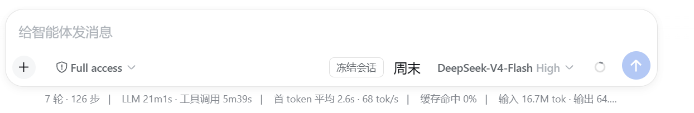

<p align="center">
  <strong>Portão automático de sessão nas horas de pico: modo fim de semana + pausa automática no pico + veredito bidimensional de fontes oficiais + congelamento a nível de sessão + nova tentativa automática no backend</strong>
</p>


<p align="center">
  <a href="README.en.md">English</a> · <a href="README.md">中文</a> · <a href="README.ja.md">日本語</a> · <a href="README.ko.md">한국어</a> · <a href="README.fr.md">Français</a> · <a href="README.de.md">Deutsch</a> · <a href="README.it.md">Italiano</a> · <a href="README.ru.md">Русский</a> · <a href="README.es.md">Español</a> · <strong>Português</strong>
</p>
<p align="center">
  <a href="LICENSE"></a>
  
  
</p>

# dsh-session-guard

- [English README](./README.en.md)
- [中文 README](./README.md)
- [日本語 README](./README.ja.md)
- [한국어 README](./README.ko.md)
- [README en français](./README.fr.md)
- [README auf Deutsch](./README.de.md)
- [README in italiano](./README.it.md)
- [README en ruso](./README.ru.md)
- [README en español](./README.es.md)
- [README em português](./README.pt.md)
- [Installation guide](./INSTALL.md)
- [中文安装指南](./INSTALL.zh.md)
- [日本語インストールガイド](./INSTALL.ja.md)
- [한국어 설치 안내](./INSTALL.ko.md)
- [Guide d'installation en français](./INSTALL.fr.md)
- [Installationsanleitung auf Deutsch](./INSTALL.de.md)
- [Guida all'installazione in italiano](./INSTALL.it.md)
- [Руководство по установке на русском](./INSTALL.ru.md)
- [Guía de instalación en español](./INSTALL.es.md)
- [Guia de instalação em português](./INSTALL.pt.md)
- [Changelog](./CHANGELOG.md)
- [日本語 changelog](./CHANGELOG.ja.md)
- [한국어 changelog](./CHANGELOG.ko.md)
- [Changelog en français](./CHANGELOG.fr.md)
- [Changelog auf Deutsch](./CHANGELOG.de.md)
- [Changelog in italiano](./CHANGELOG.it.md)
- [Changelog en ruso](./CHANGELOG.ru.md)
- [Changelog en español](./CHANGELOG.es.md)
- [Changelog em português](./CHANGELOG.pt.md)

> **Nota de compatibilidade:** a v0.1.1 já inclui dicionários em japonês (`ja`) e coreano (`ko`), mas as versões oficiais atuais do DSH só expõem `zh` e `en` através do `LocaleRuntime`. Num DSH sem modificação, selecionar `ja` ou `ko` falha com `locale "<id>" is not registered`. É preciso esperar que o DSH oficial acrescente os identificadores de locale correspondentes. Usuários avançados podem manter um fork do DSH para ampliá-lo.

> **▼ Compatibilidade de versões do DSH**
>
> | Versão do DSH | Carregamento | Registro de configurações | Eventos de sessão / portão | Metade cliente |
> | --- | --- | --- | --- | --- |
> | 0.1.0-rc.7 ~ 0.1.1-rc.x | ➖ fora desta linha (versões históricas anteriores a `legacy/0.1.2`) | `ctx.settings.register(ns, schema, { base })` | ✅ mesma forma | ✅ sem depender de valores de plataforma |
> | 0.1.2-alpha.2+ / 0.1.2-rc.1 | ➖ fora desta linha → usar `legacy/0.1.2` (npm ```dsh-0.1.2`) | `register` permanece (acrescenta `installSection`) | ✅ mesma forma | ✅ sem depender de valores de plataforma |
> | **0.2.0-rc.1+** | ✅ (**esta linha**, dist-tag `dsh-0.2.0`, npm `4.0.0`) | declarativo: os campos `.volatile()` do Config são projetados pelo host como formulários, `register` removido | ✅ eventos lidos pela dupla via `snapshotEvents()` | ✅ cartão de configurações do cliente migrado para `configForms` |
> | 0.1.7-rc.1+ | ✅ (branch `compat/0.1.7`, dist-tag `dsh-0.1.7`) | declarativo: os campos `.volatile()` do Config são projetados pelo host como formulários, `register` removido | ✅ eventos lidos pela dupla via `snapshotEvents()` | ✅ cartão de configurações do cliente migrado para `configForms` |
> | 0.1.5-rc.2 | ✅ (branch `compat/0.1.5`, dist-tag `dsh-0.1.5`) | `register` ainda presente (namespaces como strings) | ✅ eventos lidos pela dupla via `snapshotEvents()` | ✅ |
>
> **Identidade desta linha**: branch `compat/0.2.0`, número de versão npm **`4.0.0`** (semver), dist-tag **`dsh-0.2.0`**.
> Os `engines.dsh` do `package.json` e do `dsh.plugin.json` e os quatro pares ```deepseek-ai/dsh-client-*`
> são unificados em `>=0.1.0-rc.2 <0.3.0-0`; o limite inferior do par ```deepseek-ai/cordis` se alinha ao `^4.0.4` da linha do host.
> Historicamente o README usou «2.x / 3.x» como **apelidos de linha**: era uma costume narrativa, **não números de versão
> baixáveis do registro** — guie-se sempre pelas versões npm `0.3.1` (linha 0.1.2), `3.0.0`/`3.0.1` (linha 0.1.5),
> `3.2.4` (linha 0.1.7) e `4.0.0` (linha 0.2.0).
>
> **Adaptação a 0.2.0 (branch compat/0.2.0, npm 4.0.0)**:
> a API de plugins que este complemento usa (manifest/settings/HMR/slot/sessão V4) é, no 0.2.0-rc.1, totalmente compatível com o 0.1.7;
> a adaptação é uma simples troca de metadados (peer/engines/dist-tag/versão 4.0.0). Correções de engenharia alinhadas junto com a base:
> ① `src/client/family-section.tsx` entra no controle de versões (antes existia só na árvore de trabalho local, um checkout limpo não compilava);
> ② a configuração do eslint remove o `no-unused-vars` do núcleo, que marcava erroneamente parâmetros de assinaturas de tipos TS; a linha de base do lint volta a estar toda verde;
> ③ as guardas estáticas de assinatura das rotas de escrita v4 (`tests/source-kind.test.mjs`) entram nesta linha junto com a base;
> ④ o par ```deepseek-ai/cordis` se alinha a `^4.0.4` (os pacotes de UI do host 0.2.0-rc.1 declaram `~4.0.4`; o anterior `^4.0.1` não entrava em conflito, mas seu limite inferior era velho demais).
>
> **Onde ficam as outras linhas**: para hosts DSH `0.1.2-rc.x` use o branch **`legacy/0.1.2`** (dist-tag npm
> `dsh-0.1.2`, versão `0.3.1`). **`main` está congelado em `0.2.0-beta.1` e não é mais o branch de publicações da linha 0.1.2.**
> Para hosts DSH `0.1.0-rc.7` ~ `0.1.1-rc.x` use versões históricas ≤ `0.1.2`.
> Definições das fontes dos campos:
> `mine-dsh-plugins/improve-dsh-plugins/DSH-PLUGIN-VERSION-DISTRIBUTION-STRATEGY.md` §2.2.
>
> **Adaptação a 0.1.5 (branch compat/0.1.5, npm 3.0.0)**:
> ① dupla via para `agent.followup` — o 0.1.5 converte o Inbox numa projeção somente de leitura do loop do agente; se `followup`
> já não existir, recorre-se a `agent.send`, e se nenhum dos dois existir degrada para um aviso sem lançar erros (rede de segurança para a retomada);
> ② as mensagens de retomada acrescentam a `source` o campo `form: 'instructions'` (contrato ContextFormed do 0.1.5, versões anteriores o ignoram);
> ③ `webServer.register` é envolvido em try/catch: uma falha de registro fica só no log e não derruba o carregamento de plugins do host;
> ④ o 0.1.5 remove o acesso de matriz a `session.events`; a leitura de eventos passa pela via principal `snapshotEvents()` +
> reserva na matriz antiga (afeta apenas as duas rotas auxiliares `findToolOutcome` / `lastUserPrompt`, a comparação por tipo de evento não muda).
> Verificado que o contrato `WebRoute` do 0.1.5 (exact/prefix + SSE) não muda: o cliente
> `fetch('/session-guard/...')` não precisa do prefixo `/api`.
> A tabela de compatibilidade abaixo abrange duas gerações de API (0.1.1 / 0.1.2); esta linha só reivindica a linha 0.1.5.
> `session/event`, `agent.cancel`, `goals.pause`,
> `agent.followup`, `commands.register`, `timer.interval`, `webServer.register`,
> `agent/request`, `llm.listConfigurableProviders`, `settings.register/get` têm assinaturas
> idênticas entre `dsh-v0.1.1-rc.2` e `dsh-v0.1.2-rc.1` (esta linha está verificada até `dsh-v0.1.5-rc.2`);
> o único ponto que exige leitura dupla é a forma do id de chamada que o `tool/result` registra (prioridade de `content[].toolCallId`,
> reserva em `source.callId`), extraído para `src/tool-call-id.js` com testes unitários — nos registros de reprodução de ambas as versões podem aparecer as duas formas.
> Desde o 0.1.5 o acesso de matriz a `session.events` está removido; esta linha lê por `snapshotEvents()` (mantendo a reserva da matriz antiga),
> afetando apenas as duas rotas auxiliares `findToolOutcome` / `lastUserPrompt`.
> O evento `model/selection` existe **somente desde 0.1.2**, serve apenas para acelerar a troca de modelo e exige sempre detecção de capacidade; a superfície de configurações usa só
> a interseção de `register` + `get` (nunca `installSection` / o removido `installSettingsSection`).
> Script sentinela contra deriva: `tools/check-api-drift.ps1` (esta linha verifica por padrão contra `dsh-v0.1.5-rc.2` a existência das interfaces necessárias).

> Pausa automaticamente as sessões em execução durante as horas de pico e as retoma automaticamente fora do pico e nos fins de semana; junto com o botão de congelamento do input-traffic consegue um bloqueio **a nível de sessão**; a **nova tentativa automática** do backend cede a vez durante o congelamento/o portão. O núcleo baseia-se num **portão de sessão próprio** (`agent.cancel keepInbox + goals.pause + session/event fronteira segura + retomada por followup`) e não depende mais do dsh-task-control.

Complemento cordis montado com o comando `dsh plugin` e um patch do bundle — sem modificar o código-fonte do dsh e sem PR.

> 💡 **Por que é recomendado**: o DeepSeek aplica desde 2026-08-17 uma **cobrança por horas de pico e vale** — nas horas de pico (horário de Pequim 9:00-12:00, 14:00-18:00) o preço unitário é o **dobro** do horário de vale (incluindo meio-dia, noite, fins de semana e feriados). Este complemento detém automaticamente as sessões em execução durante o pico e as retoma automaticamente ao sair dele; execuções longas escalonadas podem economizar até **50 %**; o congelamento manual (com o botão do input-traffic) permite um controle ainda mais fino, sessão a sessão.

## Resumo de funcionalidades

- **Modo fim de semana**: identifica os fins de semana (com `Intl.DateTimeFormat` conforme o fuso horário configurado, evitando o clássico erro de 8 horas no limite UTC+8 do `getUTCDay()` cru para o horário de Pequim) → nos fins de semana são ignorados pico e vale e a execução segue livre.
- **Pausa automática no pico (global)**: ao entrar no pico (e se não for fim de semana), pausa automaticamente todas as sessões raiz `running`; ao sair do pico todas são retomadas automaticamente — **chave global, sem gestão manual**.
- **Veredito bidimensional de fontes oficiais (providerGuard)**: nas horas de pico só se bloqueia **se o destino da requisição for uma fonte oficial do DeepSeek**; com provedores locais/de terceiros (como `local-35b`) a execução segue normal, sem ser afetada pelo portão de pico. Critério do veredito = lista explícita de ids → endpoint de `baseURL` → endpoint padrão do catálogo → id embutido.
- **Rede de segurança a nível de requisição + fila diferida**: sessões iniciadas depois do começo do pico, ou trocadas no meio do caminho para uma fonte oficial, são capturadas pela guarda a nível de requisição `agent/request` (por padrão `hold`: a requisição fica suspensa sem erro e é liberada automaticamente ao sair do pico).
- **Congelamento / retomada a nível de sessão**: porta redundante `sessionGuard` + `POST /session-guard/rpc`, conectado sessão a sessão pelo botão de congelamento do input-traffic; também oferece os comandos manuais `/pause /resume /cancel`.
- **Nova tentativa automática no backend (D9)**: falhas transitórias de turn/end (error/429/max-tokens) são retomadas automaticamente com backoff adaptativo; falhas permanentes param; **cede a vez durante congelamento/portão**, nunca o contorna.
- **fail-open**: portão de sessão próprio indisponível, session-guard não instalado, serviço de configurações ausente — em todos os casos degradação silenciosa, nunca uma falha por causa de uma dependência.

## Prévia da interface

Captura de uma execução real (Windows, dsh web) — modo fim de semana ativo:

<figure>
  
  <figcaption>Modo fim de semana ativo: o distintivo de «fim de semana» da área de entrada aparece destacado, ao lado de «Congelar sessão»; nos fins de semana são ignorados pico e vale e as sessões correm livres.</figcaption>
</figure>

## Instalação

```bash
# Hosts DSH 0.1.5-rc.x (esta linha, dist-tag dsh-0.1.5)
dsh plugin --profile web add dsh-session-guard@dsh-0.1.5

# ou diretamente do branch git
dsh plugin --profile web add github:drscrewdriver/dsh-session-guard#compat/0.1.5

# Os hosts DSH 0.1.2-rc.x devem usar a linha 0.1.2
dsh plugin --profile web add dsh-session-guard@dsh-0.1.2
```

`compat/0.1.5` é a linha dedicada ao DSH `0.1.5-rc.x`, número de versão npm **`3.0.0`**; os hosts DSH `0.1.2-rc.x` devem usar o
branch **`legacy/0.1.2`** (dist-tag npm `dsh-0.1.2`, versão `0.3.1`). **`main` está congelado em `0.2.0-beta.1`,
não é mais o branch de publicações da linha 0.1.2.**

> ⚠️ Não confie no nome de pacote nu `dsh-session-guard`: a etiqueta `latest` do npm não pode servir ao mesmo tempo duas linhas de
> versão mutuamente exclusivas (seus `engines.dsh` são exclusivos pelas regras de semver para prerelease) — é preciso indicar sempre o dist-tag de forma explícita.

Depois de instalar, reinicie o dsh web e atualize a página.

## Configurações (Configurações → Plugins → session-guard, chaves simples)

| Chave | Padrão | Descrição |
|---|---|---|
| `enabled` | on | **Pausa/congelamento automático de sessões nas horas de pico**: pausa automaticamente as sessões em execução durante as horas de pico |
| `stepLevelPause` | on | **Portão a nível de passo**: no pico fecha o portão **antes** da requisição ao modelo do próximo passo (antes e com mais economia que a pausa a nível de turno); off volta à pausa a nível de turno |
| `providerGuard` | on | **Veredito bidimensional de fontes oficiais**: no pico só são bloqueadas as fontes oficiais do DeepSeek, os provedores locais/de terceiros seguem normalmente |
| `guardSubagents` | on | **Incluir requisições de subagentes**: as requisições de subagentes também são cobradas, por padrão também são bloqueadas |
| `offPeakAutoResume` | on | **Retomada automática fora de pico**: as sessões pausadas são retomadas automaticamente nas horas de vale; off não há retomada automática ao sair do pico (é preciso ação manual) |
| `weekendMode` | on | **Modo fim de semana**: identifica os fins de semana → sem pausa automática nos fins de semana (não há pico, executa livremente) |
| `deferredResume` | on | **Retomada automática após o pico**: off as requisições/sessões diferidas não se retomam sozinhas, é preciso um `/resume` manual |
| `queueFallback` | on | Reserva na fila de espera sob bloqueio quando o portão de sessão próprio não está disponível (fail-open) |
| `retryEnabled` | off | **Nova tentativa automática (backend)**: retomada automática após falhas transitórias (desligada por padrão, conservadora) |

Configuração adicional:

- `timezone` (por padrão Asia/Shanghai) — zona usada para a **detecção do fim de semana** e a exibição do distintivo; **não afeta a detecção de pico/vale** (sempre horário de Pequim);
- `peakWindows` (por padrão 09:00–12:00 / 14:00–18:00) — janelas de pico/vale no horário de Pequim (UTC+8), em linha com a cobrança oficial do DeepSeek;
- `pauseMode` (`safe`/`force`), `pauseReason` (`wait`/`stop`) — forma de efetivar a pausa;
- `stepGateTimeoutMs` (por padrão 300000) — tempo máximo de espera do portão de passo; ao vencer, o portão é liberado e **escala para uma pausa a nível de turno** (antibloqueio, sem «um passo a cada 5 minutos» e o gotejamento de tokens que isso implica);
- Veredito de fontes oficiais: `officialProviders` (ids de provedores oficiais adicionais, separados por vírgulas, prioridade máxima), `officialBaseURLs` (lista de hosts de endpoints oficiais, por padrão `api.deepseek.com`);
- Fila diferida: `deferredMode` (`hold` mantém em espera / `error` dá erro e difere), `deferredResumeText` (texto de retomada ao sair do pico), `deferredMaxHoldMs` (limite de espera, 6 horas por padrão, ao vence vira erro);
- Parâmetros da nova tentativa: `retryText`, `retryGraceMs`, `retryCooldownMs`, `retryBackoffFactor`, `retryBackoffMaxMs`, `retryMaxConsecutive`.

## Comportamento

### Portão automático de pico (global)

- **Entrada no pico** (e não fim de semana): com `stepLevelPause` ligado o turno **já não é interrompido de imediato** — a sessão avança com naturalidade até o próximo limite `agent/pre-step`, onde o portão de passo é fechado (ver a seção seguinte); desligado, chama `gate.stopNextTurn` sobre todas as sessões raiz `running` (pausa real pelo portão de sessão próprio, ou reserva na fila de espera sob bloqueio conforme `queueFallback`);
- **Saída do pico / fim de semana**: primeiro `releaseAll` libera os passos retidos (o turno continua no seu lugar), depois `gate.resume` sobre **todas** as sessões — controlado pela chave `offPeakAutoResume`, desligada não há retomada automática ao sair do pico;
- **Fuso horário de pico/vale**: sempre horário de Pequim (`Asia/Shanghai`), em linha com a base de cobrança oficial do DeepSeek, sem ser afetado pela configuração `timezone`;
- Máquina de estados: instância única `NORMAL ↔ PAUSED_PEAK` (`scheduler.js`), movida por um único tick de 30 s.

### Portão a nível de passo (v0.2.0, a chave da economia de tokens)

Engatilhada na cascata `agent/pre-step`: o turno é suspenso **antes de ocorrer a requisição ao modelo do próximo passo**.

- **Condições de fechamento** (todas necessárias): `enabled` + `stepLevelPause` + `step > 1` + pico (horário de Pequim, não fim de semana) + provedor de destino oficial (`providerGuard`, se desligado bloqueia todos) + sessão não retida já a nível de requisição + não pulada manualmente neste pico;
- **Por que `step > 1`**: o primeiro passo de um turno é coberto pela guarda a nível de requisição, para que os dois portões não se sobreponham;
- **Vias de liberação**: ① botão «⏸ em pausa (continuar)» / `POST /session-guard/rpc {action:'stepResume'}` / `/resume` → deixa passar o passo atual e **para de bloquear esta sessão pelo resto do pico**; ② saída do pico → tudo é liberado, o turno continua no seu lugar (**não é preciso followup**); ③ botão de congelamento / `/pause` / `/cancel` → o portão é liberado e passa para a pausa a nível de turno; ④ abort da `signal` (cancelamento do usuário) → liberação;
- **Escalonamento por tempo**: uma suspensão maior que `stepGateTimeoutMs` (5 minutos por padrão) → o portão é liberado e **escala para uma pausa force a nível de turno**, com retomada uniforme ao sair do pico (sem travamentos definitivos nem gotejamento de tokens durante o pico);
- **Estado**: `GET /session-guard/state?session=<id>` devolve `paused: { step, turn }` e `stepGate: { held, since, bypass }`; o `paused` da porta de serviço `state()` **continua sendo booleano** (compatibilidade retroativa), o estado do passo vai em `pausedStep`;
- **Não é persistido**: a suspensão é uma Promise no processo, perde-se ao reiniciar (evita estados fantasmas).

#### Botões «Pausar sessão / Retomar sessão» (fornecidos pelo session-guard)

O botão «Pausar sessão» à direita da área de entrada (slot `conversation.input.right`, id `session-guard-pause`, order 20, à esquerda do «❄ Congelar e acrescentar» do input-traffic):

- sem pausa → «Pausar sessão», **clicável**: o clique chama `stepPause` e pausa a sessão **antes da requisição ao modelo do próximo passo** (sem interromper o passo atual; o passo 1 também é retido, sem condições de pico/vale nem de provedor);
- pausado → «Retomar sessão», o clique chama `stepResume`: deixa passar o passo atual e para de bloquear esta sessão pelo resto do pico;
- **Impulso de eventos**: `GET /session-guard/events?session=<id>` (SSE) notifica **no instante** as mudanças de estado do portão de passo — quando o pico fecha o portão automaticamente o botão passa logo para «Retomar sessão», sem esperar pelo sondeo; além disso, um sondeo de `/session-guard/state` a cada 10 segundos age como rede de segurança (converge mesmo com o SSE indisponível/desconectado);
- estilo alinhado aos botões de input-traffic da mesma fileira (24 px de altura / 6 px de raio / fonte de 12 px / mesmos tokens CSS), com resposta visual ao passar o mouse e no estado de pausa.

### Bloqueio de sessão (congelamento)

- **Porta redundante**: `ctx.provide('sessionGuard', service)` — `stopNextTurn(sessionId)` / `resume(sessionId)` / `lockQueue(sessionId)` / `unlockQueue(sessionId)` / `state(sessionId)`;
- **Ponte RPC**: `POST /session-guard/rpc { action, sessionId }` — o botão de congelamento do input-traffic chama `stopNextTurn` / `resume` **sessão a sessão** conforme `sessionId`; é omitido silenciosamente se este complemento não estiver instalado (fail-open D8);
- **Comandos manuais**: `/pause [force|safe] [stop|wait]`, `/resume [confirm] [rerun|skip]`, `/cancel` — agem sobre a sessão que os invoca (tomando `invocation.agent.id`).

### Nova tentativa automática no backend (D9)

Escuta `turn/end` e classifica as falhas:

- **Falhas transitórias** (error/429/max-tokens, etc.) → retomada automática `followup(retryText)` com backoff adaptativo;
- **Falhas permanentes** (autenticação/saldo/modelo/limite de contexto) → param;
- **Cede a vez durante congelamento/portão**: não tenta de novo quando `isFrozen(sessionId)` é verdadeiro (queueLocked / paused / taskControl paused);
- A intervenção do usuário ou um turno com sucesso reiniciam o contador de falhas consecutivas.

### Distintivo de estado (visualização no frontend)

À direita da área de entrada aparece um distintivo de estado **puramente informativo** que reflete em tempo real a fase atual:

| Fase | Texto do distintivo | Classe CSS | Significado |
|---|---|---|---|
| `peak` (veredito bidimensional ativo) | 高峰·拦官方 | `sg-peak` | Horas de pico, só são bloqueadas as requisições a fontes oficiais do DeepSeek |
| `peak` (veredito bidimensional inativo) | 高峰·全部暂停 | `sg-peak` | Horas de pico, todas as sessões em pausa |
| `off-peak` | 谷时 | `sg-off` | Fora de pico, as sessões funcionam normalmente |
| `weekend` | 周末 | `sg-weekend` | Fim de semana (com o modo fim de semana ativo), são ignorados pico e vale |

- **Sondagem**: a cada 15 segundos é requisitado `GET /session-guard/status`, para obter o `phase` global, `providerGuard`, `held`, `deferred`, `stepHeld`;
- **fail-open**: rota inacessível, erro de rede ou `enabled` desligado → o distintivo se oculta em silêncio, sem afetar nenhuma sessão;
- **Independente do input-traffic**: o distintivo é desenhado apenas pelo cliente do session-guard, mostra-se **sem precisar de instalar o complemento input-traffic**. O input-traffic só aporta o botão de congelamento, sem relação de dependência com o distintivo;
- **Tooltip**: ao passar o mouse mostra `fase · fuso horário · modo fim de semana · critério do veredito · números de retenções/diferidos/retensões de passo`.

### Critério de veredito de fontes oficiais (providerGuard)

No pico as sessões não são detidas sem mais: primeiro verifica-se se «a rota pela qual esta requisição realmente seguirá é uma fonte oficial do DeepSeek»:

| Prioridade | Base | `matchedBy` | Exemplo |
|---|---|---|---|
| 1 | lista explícita de ids em `officialProviders` | `explicit` | o usuário declara oficial o seu próprio gateway |
| 2 | host da `baseURL` normalizada em tempo real | `endpoint` | `deepseek-official` apontando para um relé → **não é bloqueado** |
| 3 | endpoint por padrão embutido no catálogo | `endpoint-default` | a rota `deepseek` do pi-ai aponta por padrão para a API oficial → **é bloqueada** |
| 4 | lista de ids embutida (`deepseek-official`) | `route-id` | reserva quando o endpoint não é legível |
| 5 | qualquer outra coisa | `unknown` | não oficial, é deixado passar |

- **O endpoint pesa mais que o id**: uma configuração chamada `deepseek-official` mas com `baseURL` apontando para um relé **não** é bloqueada por engano; ao contrário, a rota `deepseek` embutida do pi-ai tem por padrão a API oficial como endpoint e **não** escapa do bloqueio.
- **Origem dos endpoints**: `ctx.get('llm').listConfigurableProviders()` localiza a entrada do catálogo → `ctx.settings.get(settingsNs)` lê a `baseURL` via `settingsPath` (só são lidos campos não secretos, o valor de `apiKeyEnv` jamais é lido). É recalculado a cada requisição e não é cacheado → mudanças a quente na configuração de um provedor surtem efeito no instante.
- **Mudar para não oficial retoma a sessão**: se após a pausa de pico a sessão for trocada para um provedor local/de terceiros (evento `model/selection` desde 0.1.2+) → essa sessão é retomada automaticamente (sujeito a `deferredResume`); só são tocadas as sessões que este complemento pausou ao entrar no pico, as pausadas manualmente com `/pause` **jamais** são tocadas. Sem esse evento no 0.1.1 → degrada para «a próxima requisição ou um `/resume` manual».
- **Endpoint ilegível**: serviço `llm` ausente, estrutura do namespace mudada, campo não string — sempre degrada para o veredito por id / endpoint embutido registrando o `matchedBy`, **nunca lança exceção**.
- **Investigar um veredito errado**: `GET /session-guard/provider?provider=<id>` devolve {`official`, `matchedBy`, `endpoint`}.

### Guarda a nível de requisição e fila diferida

- **Por que a nível de requisição**: o tick de 30 s só atende, no salto `NORMAL → PAUSED_PEAK`, às sessões que estavam `running` naquele momento; as sessões iniciadas depois do começo do pico ou trocadas no meio do caminho para uma fonte oficial escapam. A cascata `agent/request` é a rede que passa **a cada requisição**.
- **O veredito baseia-se no valor devolvido por `next()`**: o middleware de seleção de modelo sobrescreve provider/model dentro da cascata com os valores escolhidos na interface, então é preciso fazer primeiro `await next()` e julgar depois.
- **Modo hold (padrão)**: a requisição fica suspensa, **sem enviar nem dar erro**, e é liberada no instante exato da saída do pico (`msUntilOffPeak` com temporização precisa, tick de 30 s como rede de segurança); o cancelamento do usuário (abort) interrompe normalmente.
- **Modo error**: lança um erro reconhecível `PEAK_DEFERRED` + anota na fila diferida, com retomada ao sair do pico mediante `deferredResumeText` (sem retomada automática se `deferredResume` estiver desligado).
- **Proteção de teto**: se `deferredMaxHoldMs` (6 horas por padrão) vencer sem que o pico acabe → vira erro, para evitar suspensões infinitas.
- **Regra férrea de exclusão mútua**: durante um hold **jamais** se pede además a pausa pelo portão de sessão (a pausa espera uma fronteira segura à qual uma requisição retida nunca chegará → ficariam se esperando mutuamente). Ao entrar no pico são puladas as sessões já retidas.
- **Sem persistência**: a fila diferida é uma promise no processo, desaparece ao reiniciar.

### Limites (explícitos fora do escopo)

- **Sem troca de provedor / sem redirecionamento**: só bloqueia, não roteia;
- **A compactação não passa por `agent/request`**: não pode ocorrer enquanto uma sessão estiver em pausa; uma compressão disparada manualmente durante o pico pode alcançar a fonte oficial (este complemento não intercepta a camada `ctx.llm.stream`);
- **0.1.1 não tem o evento `model/selection`**: a retomada automática depois de mudar para uma fonte não oficial degrada para «esperar a próxima requisição ou um `/resume` manual» (imediato desde 0.1.2);
- **Sem novas dependências npm**, sem leitura nem escrita de credenciais, e as novas tentativas 429 / de camada de transporte do `dsh-llm-retry` não são tocadas.

### Tratamento e validação de fusos horários

- A detecção de zona baseia-se em **nomes de zona IANA** (como `Asia/Shanghai`, `Asia/Tokyo`, `Asia/Seoul`), projetados pelo `Intl.DateTimeFormat` sobre o relógio de parede da zona configurada, **sem depender do `getUTCDay()` cru** — evitando o clássico erro de 8 horas no limite UTC+8 do horário de Pequim (sábado 00:30 horário de Pequim: em UTC ainda é sexta);
- `Intl.DateTimeFormat` é ao mesmo tempo a camada de validação: um nome de zona inválido (como `Foo/Bar`) lança uma `RangeError`, que um try-catch externo degrada em silêncio para a zona padrão `Asia/Shanghai` (fail-open);
- As janelas de pico são **fechadas pela esquerda e abertas pela direita** `[start, end)`, com suporte a janelas que cruzam a meia-noite (como `22:00–06:00`);
- A configuração `timezone` se comporta igual em todos os idiomas (zh/en/ja/ko) — os nomes de zona IANA do `Intl.DateTimeFormat` não dependem do locale: com interface japonesa/coreana o comportamento da zona é idêntico ao do chinês.

### Divisão de tarefas com o input-traffic: um «detém», o outro «enfileira»

Ambos agem sobre **elos distintos da mesma cadeia**, e a fronteira é definida pelo próprio modelo de inbox do DSH:

```
Entrada do usuário ──(input-traffic escolhe o trecho)──▶ filas de espera next-step / next-turn
                                        │
                          agent/pre-step ──(portão de passo deste complemento)──▶ deixar passar / reter
                                        │
                            agent/request ──(retenção a nível de requisição deste complemento)──▶ deixar passar / reter
                                        │
                                     requisição ao modelo
```

**Semântica das filas do DSH (duas filas, não confunda)**

| Fila | Significado | Quando é consumida |
|---|---|---|
| `next-step` | «Entrada à espera do próximo limite de passo» | No próximo `agent/pre-step`: **no mesmo nível de um resultado de ferramenta**, outro passo dentro do mesmo turno |
| `next-turn` | «Prompt à espera de um turno independente» | Ao fechar o turno atual, arrancado como **turno novo** |

`Inbox.claim()` **sempre esvazia primeiro `next-step`** e só toma **1** elemento de `next-turn` quando esse limite abre um turno novo; o primeiro passo de um turno lê next-turn, todos os seguintes leem next-step.

**Divisão de responsabilidades**

- **session-guard = deter**: só decide «quando se pode avançar» e **jamais toca o conteúdo nem a ordem das filas**.
  - portão de passo (`agent/pre-step`): retém **antes** da requisição ao modelo do próximo passo;
  - pausa a nível de turno (`agent.cancel({keepInbox:true})` + `goals.pause` + fronteira segura): detém o turno atual, **as filas ficam como estão**;
  - guarda a nível de requisição (hold em `agent/request`): retém **esta única requisição ao modelo**.
- **input-traffic = enfileirar**: só decide «a qual fila vai a entrada do usuário, com que trecho e quando é consumida».
  - três trechos = a qual fila vai: vermelho «interromper» faz primeiro `cancel()` e depois `steer`; amarelo «intercalar» faz `steer` (→ `next-step`, o próximo passo do mesmo turno); verde «na fila» fica em `next-turn`;
  - congelamento = extrair as linhas `queued` + `steering` (conservando o trecho) + bloqueio do composer + chamada a `sessionGuard.stopNextTurn`; retomada = tirar o bloqueio → primeiro `sessionGuard.resume` → reencaminho conforme o trecho.

**Duas regras férreas no ponto de encontro**

1. **O congelamento precisa deixar que este complemento libere primeiro o portão de passo**: o portão de passo está engatilhado em `agent/pre-step`, enquanto a pausa a nível de turno espera um evento na fronteira segura — ficariam se esperando mutuamente (`pauseTask` / `cancelTask` deste complemento fazem primeiro `release`);
2. **Com o portão de passo retido, as mensagens já foram tomadas**: `preStep()` faz `inbox.claim()` antes de despachar a cascata, então as entradas novas fazem fila atrás do lote já tomado; `keepInbox` só se aplica à pausa a nível de turno.

**Nenhuma invasão mútua**: o input-traffic não escuta `agent/pre-step` / `agent/request` (única exceção o `cancel()` explícito do trecho «interromper», pedido pelo próprio usuário); este complemento nunca reescreve o conteúdo nem a ordem de `next-step` / `next-turn`.

Quanto aos botões: os botões «Pausar sessão / Retomar sessão» deste complemento (order 20) e os do input-traffic «❄ Congelar e acrescentar / Retomar e acrescentar» (order 30) aparecem lado a lado sem se substituir — os primeiros governam o portão de passo, os segundos a extração da fila + o congelamento a nível de turno.

## Porta redundante `sessionGuard`

```js
{
  stopNextTurn(sessionId, opts),  // detém o próximo turno da sessão (portão de sessão próprio / reserva na fila de espera sob bloqueio)
  resume(sessionId, opts),        // retoma (confirm + choice: rerun|skip)
  lockQueue(sessionId, reason),   // bloqueia explicitamente a fila
  unlockQueue(sessionId),         // desbloqueia explicitamente
  stepPause(sessionId),           // pede manualmente uma pausa a nível de passo (fechamento no próximo limite pre-step, passo 1 também)
  stepResume(sessionId, opts),    // abre o portão de passo (v0.2.0); com opts.bypass=false não pula este pico
  state(sessionId),               // { queueLocked, lockReason, paused, pausedStep, stepHeldSince, stepBypass, taskControlAvailable, taskControl }
}
```

## Rotas HTTP

- `GET /session-guard/state?session=<id>` — estado da sessão (com `paused: { step, turn, manual }` / `stepGate` / último destino / em retenção ou não / diferida ou não)
- `GET /session-guard/events?session=<id>` — **SSE**: notificação imediata das mudanças de estado do portão de passo (o botão se atualiza graças a isso)
- `GET /session-guard/settings` — configurações + disponibilidade de taskControl
- `GET /session-guard/status` — fase global atual (sondagem do distintivo de estado; inclui `stepHeld`)
- `GET /session-guard/provider?provider=<id>` — diagnóstico do veredito de fonte oficial (`official` / `matchedBy` / `endpoint`)
- `GET /session-guard/diag` — diagnóstico em tempo de execução (inclui `stepGate`)
- `POST /session-guard/rpc` — {`action: stopNextTurn|resume|lockQueue|unlockQueue|stepPause|stepResume|state, sessionId`}

## Armazenamento do estado

JSON por sessão: `$DSH_HOME/.dsh/session-guard/<sessionId>.json` (escrita atômica; pode ser anulada com `DSH_SESSION_GUARD_STATE_DIR`).

## Testes

```bash
npm test   # node --test tests/*.test.mjs (fusos horários/fim de semana/máquina de estados/portão de sessão/ponte/nova tentativa)
```

## Módulos

| Arquivo | Responsabilidade |
|---|---|
| `src/time.js` | Detecção de pico/fim de semana (com fuso horário correto) + `msUntilOffPeak` (temporização precisa da saída do pico) |
| `src/scheduler.js` | Máquina de estados pura NORMAL ↔ PAUSED_PEAK |
| `src/provider.js` | Veredito de fontes oficiais em cinco níveis (função pura: normalização de endpoint + matriz de decisão) |
| `src/provider-directory.js` | Catálogo de endpoints (`llm.listConfigurableProviders` + `settings.get`, degradação em toda a cadeia) |
| `src/deferrals.js` | Registro de diferidos (retenção / liberação / vencimento do limite / `PeakDeferredError`) |
| `src/request-guard.js` | Guarda a nível de requisição em `agent/request` (dois modos hold / error) |
| `src/step-gate.js` | **Portão a nível de passo em `agent/pre-step`** (v0.2.0: fechamento / liberação / escalonamento por tempo / bypass, o `decideStepHold` puro é testável em unidade) |
| `src/targets.js` | Rastreamento do «último destino real» da sessão (`request/header` + `model/selection`) |
| `src/wiring.js` | Orquestração da fiação (filtro de entrada no pico / fiação do portão de passo / liberação ao sair do pico / temporização precisa / limpeza ao descarregar) |
| `src/pause-gate.js` | Motor do portão de sessão próprio (agent.cancel keepInbox + goals.pause + fronteira segura + retomada por followup; libera antes o portão de passo antes de pausar) |
| `src/pause-store.js` | Persistência do estado de pausa próprio |
| `src/gate.js` | Controlador do portão de sessão (pausa real própria / reserva na fila de espera sob bloqueio, fail-open) |
| `src/bridge.js` | Porta redundante `sessionGuard` |
| `src/retry.js` | Nova tentativa automática no backend (classificação de falhas/backoff/cedência durante congelamento; curto-circuito só com o código exato `PEAK_DEFERRED`) |
| `src/detect.js` | Detecção automática (taskControl do host / ponte cliente input-traffic) |
| `src/store.js` | Estado persistente por sessão |
| `src/settings.js` | Subseção de configurações (esquema schemastery + registro fail-open) |
| `src/index.js` | apply no host (configurações/rotas/tick/provisionamento do serviço/fiação da nova tentativa/guarda de requisições) |
| `src/client/` | Metade de navegador (**botão de pausa de sessão** + distintivo de estado + cartão de configurações) |

## Licença

MIT — veja [LICENSE](LICENSE).
